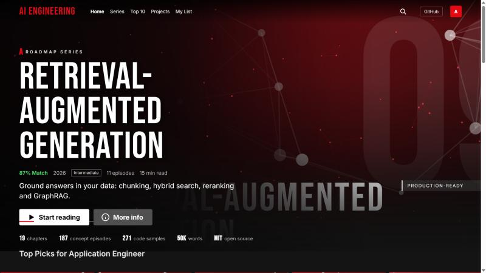
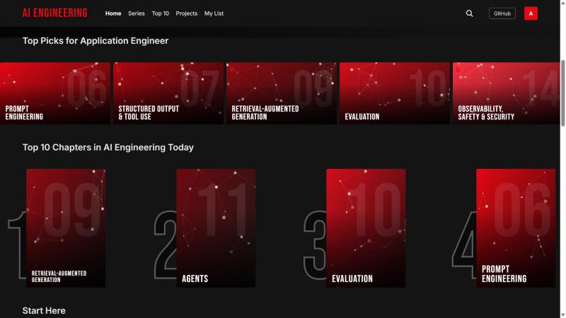
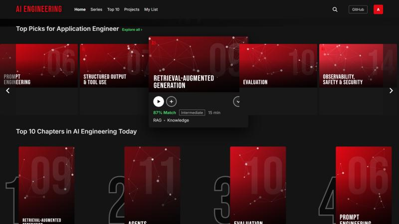
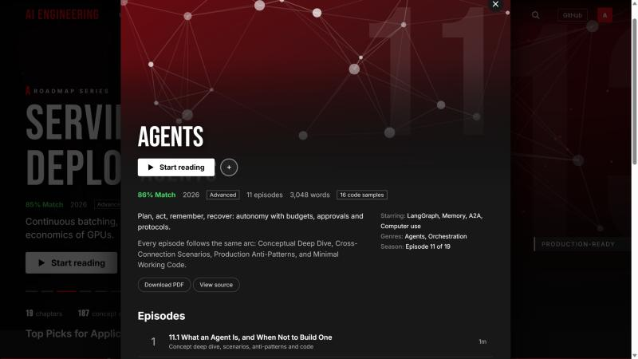
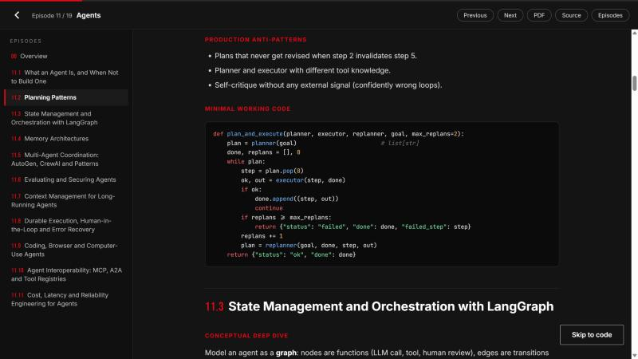
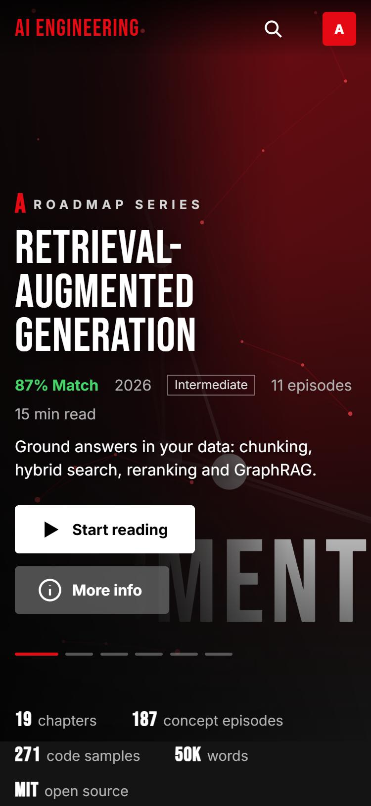
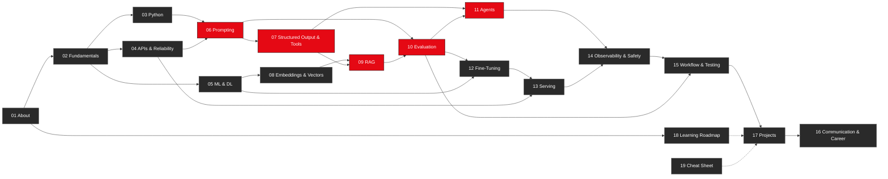
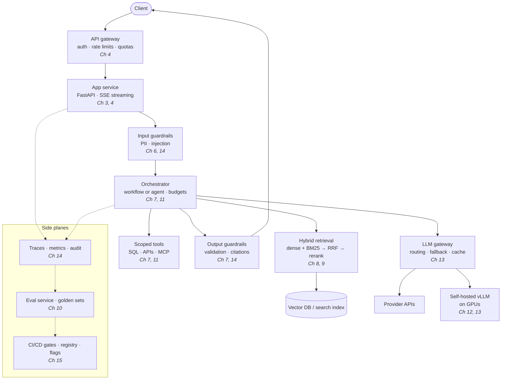

<div align="center">

<a href="https://ai-engineering-roadmap-2026-omega.vercel.app">
  
</a>

# THE ULTIMATE AI ENGINEERING ROADMAP · 2026

**19 chapters. 187 concept episodes. 270+ code blocks. One binge-able guide to building production AI systems.**

[](https://ai-engineering-roadmap-2026-omega.vercel.app)
[](LICENSE)


[**Live site**](https://ai-engineering-roadmap-2026-omega.vercel.app) ·
[Chapters](#-whats-inside) ·
[Learning paths](#-learning-paths) ·
[Architecture](#-reference-architecture) ·
[Quick start](#-quick-start) ·
[Quality](#-quality-and-verification) ·
[Contributing](#-contributing)

</div>

---

## 📖 Contents

1. [What is this?](#-what-is-this)
2. [The streaming-style site](#-the-streaming-style-site)
3. [What's inside](#-whats-inside)
4. [Anatomy of a concept](#-anatomy-of-a-concept)
5. [Learning paths](#-learning-paths)
6. [Reference architecture](#-reference-architecture)
7. [Coverage map](#-coverage-map)
8. [Quick start](#-quick-start)
9. [Repository structure](#-repository-structure)
10. [Quality and verification](#-quality-and-verification)
11. [24-week study plan](#-24-week-study-plan)
12. [Contributing](#-contributing) · [FAQ](#-faq) · [License](#-license)

---

## 🎯 What is this?

Most AI engineering material is either a model-API tutorial or a research survey. This repository is the part in between: **the engineering of reliable, measurable, secure LLM-powered systems**, written code-first and organised so you can read it in order or jump straight to the problem in front of you.

It starts from one belief: **AI engineering is software engineering with a probabilistic component.** The model is the least reliable part of the system, so most of the craft is in the scaffolding around it: validation, retrieval, evaluation, observability, cost control, and safety.

**Who it is for**

| You are... | Start with |
|---|---|
| An application engineer adding LLM features | Chapters 2, 4, 6, 7, 9, 10, 14, 17 |
| A search / retrieval engineer | Chapters 3, 5, 8, 9, 10, 13 |
| An ML platform engineer | Chapters 3, 4, 5, 12, 13, 14, 15 |
| An evaluation / safety engineer | Chapters 6, 10, 14, 15 |
| An agent builder | Chapters 6, 7, 11, 10, 14 |
| Switching into AI engineering | Chapters 1, 2, 3, 18, 16, 19 |
| Preparing for interviews | Chapters 16, 19, then the anti-pattern lists |

**Principles used throughout**

1. **Measure before you optimise.** No prompt, chunk size, or model swap ships without an eval number.
2. **Simplest thing that works.** Prompt → RAG → tools → fine-tuning → training, and escalate only on evidence.
3. **Failure is the default.** Every network call, parse and model output can fail; design the unhappy path first.
4. **Code over slides.** Every concept has runnable, minimal code.

---

## 🎬 The streaming-style site

Reading 50,000 words is easier when it feels like a series. The guide ships with a zero-dependency web app (`site/`, plain HTML/CSS/JS, no build step) that presents chapters as **titles**, sections as **episodes**, and learning as **binge-watching**.

<table>
<tr>
<td width="50%"><br><sub><b>Rows &amp; Top 10</b>: curated shelves, role-based "Top Picks", and a numbered Top 10.</sub></td>
<td width="50%"><br><sub><b>Hover cards</b>: expand to show match %, level, runtime, genres, and quick actions.</sub></td>
</tr>
<tr>
<td width="50%"><br><sub><b>Detail view</b>: "starring" tools, genres, and an episode list for every concept section.</sub></td>
<td width="50%"><br><sub><b>Reader</b>: episode sidebar, scroll progress, highlighted code, copy buttons, "Skip to code".</sub></td>
</tr>
</table>

<div align="center">
<br>
<sub><b>Mobile</b>: responsive down to phone widths with no horizontal scrolling.</sub>
</div>

### Features

| | |
|---|---|
| 👤 **Profiles** | "Who's building?" picks Application, Platform, Safety & Evals, or Career Switcher and reorders recommendations. |
| 🎞️ **Hero billboard** | Rotating featured chapters over an animated network canvas (respects `prefers-reduced-motion`). |
| 🔟 **Top 10 row** | The most binge-worthy chapters with outlined rank numerals. |
| 📚 **Rows by theme** | Start Here · Foundations · Build with Models · Quality & Autonomy · Customise, Ship & Protect · Projects & Career. |
| 🔥 **Trending concepts** | 16 concept sections shuffled daily. Click one to jump straight to it. |
| ▶️ **Reader with resume** | Remembers scroll position per chapter; a "Continue Reading" row appears on the home page. |
| ➕ **My List** | Save chapters for later. |
| 🔎 **Search** | Titles, taglines, tools, genres and all 187 section titles. Press `/` to focus. |
| ⌨️ **Keyboard** | `/` search · `Esc` close · `n` / `p` next / previous chapter in the reader. |
| 🔗 **Deep links** | `#/read/9` opens a chapter; `#/read/9/9.9` opens the GraphRAG section. |
| 📥 **Downloads** | Every chapter is available as Markdown (source) and PDF. |
| 🔒 **Private by design** | Progress, My List and profile live only in your browser's `localStorage`. No accounts, no tracking, no analytics. |

**Stack:** vanilla JS, one CSS file, [`marked`](https://github.com/markedjs/marked) for Markdown rendering, Google Fonts (Bebas Neue, Inter, JetBrains Mono). Poster art is generated at runtime as seeded SVG neural-network graphs, so there are no image assets to maintain. Deployed on Vercel as a static site with cache and security headers (`site/vercel.json`).

> The visual style is an homage to streaming-service UIs and uses a Netflix-like colour palette (`#E50914`, `#141414`). The project is not affiliated with or endorsed by any streaming company, and it uses a plain text wordmark rather than any trademarked logo.

---

## 📺 What's inside

Each row links to the chapter source and a PDF. *Episodes* are concept sections; *code* counts fenced code blocks.

| # | Chapter | Level | Episodes | Code | Starring | PDF |
|--:|---|---|--:|--:|---|---|
| 01 | [About this Guide](chapters/01_about_this_guide.md) | Beginner | 8 | 9 | Reading tracks, Responsible AI, Lab setup | [PDF](pdfs/01_about_this_guide.pdf) |
| 02 | [AI Engineering Fundamentals](chapters/02_ai_engineering_fundamentals.md) | Beginner | 8 | 12 | Sampling, Token economics, Model routing | [PDF](pdfs/02_ai_engineering_fundamentals.pdf) |
| 03 | [Python for AI Engineers](chapters/03_python_for_ai_engineers.md) | Beginner | 10 | 14 | asyncio, Pydantic, Polars | [PDF](pdfs/03_python_for_ai_engineers.pdf) |
| 04 | [APIs, HTTP & Reliability](chapters/04_apis_http_reliability.md) | Intermediate | 10 | 14 | SSE, WebSockets, Redis | [PDF](pdfs/04_apis_http_reliability.pdf) |
| 05 | [ML & Deep Learning Foundations](chapters/05_ml_deep_learning_foundations.md) | Intermediate | 11 | 16 | Attention, BPE, RoPE | [PDF](pdfs/05_ml_deep_learning_foundations.pdf) |
| 06 | [Prompt Engineering](chapters/06_prompt_engineering.md) | Beginner | 10 | 14 | Chain-of-Thought, ReAct, DSPy | [PDF](pdfs/06_prompt_engineering.pdf) |
| 07 | [Structured Output & Tool Use](chapters/07_structured_output_and_tool_use.md) | Intermediate | 9 | 14 | Pydantic, XGrammar, MCP | [PDF](pdfs/07_structured_output_and_tool_use.pdf) |
| 08 | [Embeddings & Vector Search](chapters/08_embeddings_and_vector_search.md) | Intermediate | 10 | 14 | HNSW, Qdrant, pgvector | [PDF](pdfs/08_embeddings_and_vector_search.pdf) |
| 09 | [Retrieval-Augmented Generation](chapters/09_retrieval_augmented_generation.md) | Intermediate | 11 | 16 | RRF, HyDE, GraphRAG | [PDF](pdfs/09_retrieval_augmented_generation.pdf) |
| 10 | [Evaluation](chapters/10_evaluation.md) | Advanced | 10 | 14 | RAGAS, LLM-as-judge, pass@k | [PDF](pdfs/10_evaluation.pdf) |
| 11 | [Agents](chapters/11_agents.md) | Advanced | 11 | 16 | LangGraph, Memory, A2A | [PDF](pdfs/11_agents.pdf) |
| 12 | [Fine-Tuning & Open Models](chapters/12_fine_tuning_and_open_models.md) | Advanced | 11 | 16 | QLoRA, DPO, GRPO | [PDF](pdfs/12_fine_tuning_and_open_models.pdf) |
| 13 | [Serving & Deployment](chapters/13_serving_and_deployment.md) | Advanced | 11 | 17 | vLLM, Triton, KEDA | [PDF](pdfs/13_serving_and_deployment.pdf) |
| 14 | [Observability, Safety & Security](chapters/14_observability_safety_security.md) | Advanced | 10 | 15 | OpenTelemetry, Guardrails, OWASP LLM | [PDF](pdfs/14_observability_safety_security.pdf) |
| 15 | [Modern Workflow & Testing](chapters/15_modern_workflow_and_testing.md) | Intermediate | 9 | 13 | GitOps, Eval gates, Registry | [PDF](pdfs/15_modern_workflow_and_testing.pdf) |
| 16 | [Communication & Career](chapters/16_communication_and_career.md) | All levels | 8 | 12 | Metric trees, STAR, Postmortems | [PDF](pdfs/16_communication_and_career.pdf) |
| 17 | [Project Roadmap](chapters/17_project_roadmap.md) | Intermediate | 12 | 18 | RAG assistant, Support copilot, Code reviewer | [PDF](pdfs/17_project_roadmap.pdf) |
| 18 | [Learning Roadmap](chapters/18_learning_roadmap.md) | All levels | 9 | 13 | Labs, Rubrics, Papers | [PDF](pdfs/18_learning_roadmap.pdf) |
| 19 | [Cheat Sheet](chapters/19_cheat_sheet.md) | All levels | 9 | 14 | Formulas, Glossary, Debugging | [PDF](pdfs/19_cheat_sheet.pdf) |

---

## 🧩 Anatomy of a concept

Every numbered section in chapters 2–15 follows the same four-part arc, so you always know where to look:

| Part | What you get |
|---|---|
| **Conceptual Deep Dive** | Mechanics, mathematical intuition where it helps, history, and edge cases |
| **Cross-Connection Scenarios** | When to use what, trade-offs, and which other chapters this connects to |
| **Production Anti-Patterns** | What goes wrong in real deployments, and how to avoid it |
| **Minimal Working Code** | Small, clean Python/config you can run and adapt |

A taste of the style (from §9.3, *Reciprocal Rank Fusion* in hybrid retrieval):

```python
from collections import defaultdict

def rrf(rank_lists: list[list[str]], k: int = 60, top: int = 10) -> list[str]:
    scores = defaultdict(float)
    for ranks in rank_lists:
        for r, doc in enumerate(ranks, start=1):
            scores[doc] += 1.0 / (k + r)
    return sorted(scores, key=scores.get, reverse=True)[:top]
```

---

## 🧭 Learning paths

Chapters form a graph, not a line. Evaluation (10) should start as soon as you have a prompt worth measuring.



---

## 🏗️ Reference architecture

Chapter 17 assembles the whole guide into one production-grade blueprint. Each box is covered by at least one chapter:



**Build order for any project:** define metrics and a golden set → naive baseline → instrument tracing → improve with evals driving every change → harden (reliability, security) → deploy with CI gates and a canary → operate with a feedback loop.

---

## 🗺️ Coverage map

| Area | Highlights |
|---|---|
| **Foundations** | Non-determinism, sampling, token economics, model landscape, failure taxonomy, build vs buy, responsible AI |
| **Python & systems** | asyncio, backpressure, generators, Pydantic, Polars/DuckDB/Parquet, profiling, testing with fakes |
| **APIs & reliability** | REST, SSE vs WebSockets, retries with jitter, circuit breakers, idempotency, Redis rate limiting, OpenAI-compatible APIs |
| **Deep learning** | Backprop, attention, KV cache, BPE/WordPiece/tiktoken, RoPE, MoE, FSDP/ZeRO, diffusion, GPU memory math |
| **Prompting** | Few-shot, CoT, ToT, ReAct, DSPy, context engineering, injection defence, conversation design |
| **Structured output & tools** | JSON schema, validation/repair loops, Outlines/XGrammar, function calling, MCP, SSRF-safe tools, streaming JSON |
| **Embeddings & search** | Dense/sparse/late-interaction, Matryoshka, HNSW/IVF/PQ, Qdrant/Milvus/Pinecone/pgvector, hybrid search, ANN recall tuning |
| **RAG** | Chunking, HyDE, parent-document, GraphRAG, RAPTOR, contextual retrieval, reranking, corrective/agentic RAG, hallucination control |
| **Evaluation** | Golden sets, RAG triad, RAGAS/TruLens, LLM-as-judge calibration, statistics, A/B tests, pass@k, annotation ops |
| **Agents** | ReAct, planning, LangGraph, memory architectures, multi-agent, coding/browser agents, A2A, durable execution |
| **Fine-tuning** | SFT, LoRA/QLoRA, DPO/ORPO, GRPO/RLVR, quantisation (GPTQ/AWQ/GGUF), synthetic data, multi-LoRA serving |
| **Serving** | Continuous batching, PagedAttention, speculative decoding, Triton, Kubernetes/KEDA, edge, serverless GPUs, SLOs |
| **Safety & security** | OpenTelemetry, Phoenix/Langfuse, guardrails, red-teaming, OWASP LLM Top 10, PII, audit logs, regulation |
| **Workflow** | CI/CD gates, GitOps, registries, reproducibility, FinOps, flaky-test handling |
| **People** | Metric translation, system design, interview bank, postmortems, career ladder, 24-week study plan |

---

## 🚀 Quick start

**Just read it.** Open the [live site](https://ai-engineering-roadmap-2026-omega.vercel.app), or browse [`chapters/`](chapters/) on GitHub, or download a PDF from [`pdfs/`](pdfs/).

**Work with the repo locally**

```bash
git clone https://github.com/vishalgwu/ultimate-ai-engineering-roadmap-2026.git
cd ultimate-ai-engineering-roadmap-2026
pip install -r requirements.txt

python scripts/audit.py            # structural audit (sections, code parses, required concepts)
python scripts/build_pdfs.py       # Markdown → PDF (markdown + xhtml2pdf)
python scripts/build_site_data.py  # regenerate the web app's data and copy chapters/PDFs into site/
```

**Run the site locally** (any static server works)

```bash
python -m http.server 4173 --directory site
# open http://localhost:4173
```

**Deploy your own copy to Vercel**

```bash
cd site
npx vercel deploy --prod
```

Code samples target **Python 3.10+**. Provider SDK calls are shown against a generic client so they port across vendors; check current SDK docs for exact model names and parameters, which change quickly.

---

## 🗂️ Repository structure

```
ultimate-ai-engineering-roadmap-2026/
├── chapters/                  # 19 chapters in Markdown: the source of truth
├── pdfs/                      # one generated PDF per chapter
├── extensions/                # expansion sections (NN.md, NNb.md) merged into chapters
├── scripts/
│   ├── audit.py               # Agent-21 structural audit
│   ├── required_concepts.json # per-chapter concept checklist the audit enforces
│   ├── build_pdfs.py          # Markdown → PDF
│   ├── merge_extensions.py    # append extensions to chapters (idempotent)
│   └── build_site_data.py     # generate site/data.js, copy chapters + PDFs
├── site/                      # the streaming-style web app (static, no build)
│   ├── index.html · styles.css · app.js · data.js · vercel.json
│   ├── chapters/ · pdfs/      # copies served to the browser
├── docs/screenshots/          # images used in this README
├── CROSSCHECK.md              # audit report: what was added, what is still missing
├── LICENSE                    # MIT
└── requirements.txt
```

---

## ✅ Quality and verification

This project was built with a deliberate **write → audit → expand** loop, and it documents its own limits.

| Check | How | Status |
|---|---|---|
| **Structure** | `scripts/audit.py` requires the four-part format in every concept section | 0 issues |
| **Python syntax** | Every ` ```python ` block is parsed with `ast` | 0 errors |
| **Runtime** | Sections that need only the standard library or NumPy were executed in a clean directory | 144 ran cleanly |
| **Concept coverage** | ~170 required terms checked per chapter | 0 missing |
| **PDFs** | Rebuilt from Markdown with embedded Unicode fonts so math symbols render | 19/19 |

**Honest limits** (see [`CROSSCHECK.md`](CROSSCHECK.md) for the full report):

- 35 sections use third-party libraries (TRL, vLLM, DSPy, MCP SDK, Qdrant, LangGraph, Redis, Polars, …). They were syntax-checked but **not executed**, and argument names drift between versions.
- Model names, prices, benchmark ranks and regulations are perishable. They are kept generic or flagged; verify against primary sources.
- Thin or absent: classical ML, recommender systems, speech-model internals, GPU kernel programming, deep legal detail per jurisdiction.
- The audit is structural. It cannot judge whether an explanation is correct. Human technical review is still valuable.

---

## 🗓️ 24-week study plan

Roughly 10 hours a week. Every phase ends with a mastery checkpoint (full rubrics in Chapter 18).

| Phase | Weeks | Chapters | You ship |
|---|---|---|---|
| 1. Foundations | 1–4 | 2–5 | A resilient async LLM client (retries, jitter, breaker, rate limits) |
| 2. Building with models | 5–10 | 6–9 | A RAG app with a 100-question golden set and measured ablations |
| 3. Quality, agents, safety | 11–16 | 10, 11, 14 | An agent with budgets and approvals, plus a red-team report |
| 4. Customise and operate | 17–22 | 12, 13, 15 | A fine-tuned, quantised model served on vLLM behind a CI eval gate |
| 5. Capstone and career | 23–24 | 16, 17 | A published write-up and rehearsed system-design interviews |

---

## 🤝 Contributing

Issues and pull requests are welcome: corrections, outdated claims, missing edge cases, new code examples, or typo fixes.

1. **Edit the chapter directly** in `chapters/NN_*.md`, or add a new section as `extensions/NNc.md` and run `python scripts/merge_extensions.py`.
2. Keep the **four-part format** for any numbered concept section.
3. Run `python scripts/audit.py`. It must report **0 issues**.
4. If you add a major topic, add a keyword for it in `scripts/required_concepts.json` so the audit protects it.
5. Run `python scripts/build_pdfs.py` and `python scripts/build_site_data.py` so PDFs and the site stay in sync.

Style: minimal runnable code, real trade-offs, a failure mode for every recommendation, and no unverifiable claims about prices or rankings.

---

## ❓ FAQ

<details>
<summary><b>Why does the site look like a streaming service?</b></summary>

Because long technical material is easier to finish when it has structure, progress and momentum: titles, episodes, "continue watching", and a Top 10. It is a UI experiment for reading, not a content claim.
</details>

<details>
<summary><b>Does the site track me?</b></summary>

No. There are no analytics, accounts or cookies. Your profile, progress and My List are stored in your browser's `localStorage` only.
</details>

<details>
<summary><b>Are the code samples production-ready?</b></summary>

They are minimal, correct-in-spirit patterns with the failure handling called out, not drop-in libraries. Adapt them, test them, and verify library calls against current docs.
</details>

<details>
<summary><b>How is this different from a typical "LLM course"?</b></summary>

The emphasis is on what breaks in production (rate limits, drift, injection, cost, regressions) and on measuring everything. Every section has an explicit *Production Anti-Patterns* part.
</details>

<details>
<summary><b>How do I keep the site in sync after editing chapters?</b></summary>

Run `python scripts/build_pdfs.py` then `python scripts/build_site_data.py`, commit, and push. Vercel redeploys from the `site/` directory.
</details>

---

## 📜 License

[MIT](LICENSE) © 2026 Vishal Fulsundar. Use it, fork it, teach with it.

<div align="center">

**If this helps you, a ⭐ on the repo helps others find it.**

Built by [@vishalgwu](https://github.com/vishalgwu) · [Live site](https://ai-engineering-roadmap-2026-omega.vercel.app)

</div>
